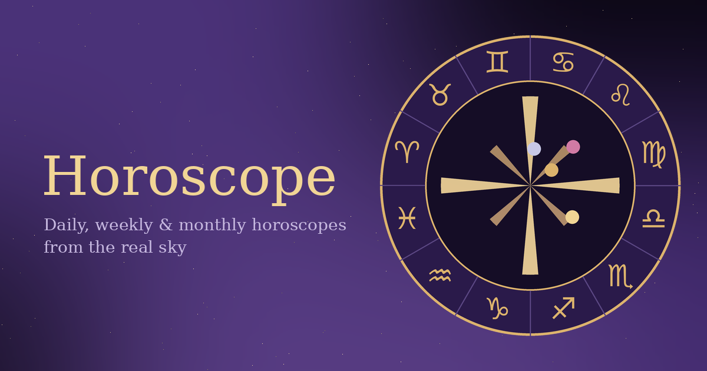

# Horoscope

Horoscopes calculated from the real sky.

An interactive horoscope application that combines real astronomical planetary positions with traditional astrology. Explore daily, weekly and monthly horoscopes based on the actual positions of celestial bodies.

**[♈ Open Horoscope](https://millaceedee.github.io/Horoscope/)**

## Features

* **12 Zodiac Signs** with individual horoscope interpretations
* **Daily, Weekly and Monthly Horoscopes**
* **Real Astronomical Positions** of the Sun, Moon and planets
* **The Sky** with planetary positions, zodiac signs and astrological houses
* **Planetary Aspects** describing interactions between celestial bodies
* **Love, Work, Money and Personal Growth** interpretations
* **Lucky Numbers, Colours, Stones and Days**
* **Compatibility** between zodiac signs
* **Astrological Encyclopedia** with information about signs and astrology
* **Bilingual Support** (English and Finnish)
* **Responsive Interface** for desktop and mobile devices

## How It Works

Horoscope uses actual astronomical positions to generate astrological interpretations based on the current sky.

Planetary positions, zodiac placements and aspects provide the astronomical foundation for the horoscope content.

The interpretations combine these positions with traditional astrological symbolism, including zodiac signs, planetary meanings and astrological houses.

## About

Horoscope is a personal project exploring astrology through real astronomical data.

Unlike generic horoscope texts based only on zodiac signs, the application considers the actual positions and relationships of celestial bodies when generating interpretations.

Astrological interpretation is symbolic and intended for reflection and entertainment, not scientific prediction.

## Try it Online

Access the horoscope application directly in your browser without installing anything.

## Source Code

The source code is available in this repository. You are welcome to explore it, learn from it and build upon it under the terms of the MIT License.

## Tutorial

Want to learn how I built Horoscope?

I've created a mini tutorial showing how I made this horoscope website. The tutorial is available on Patreon behind a paywall.

**[📖 Read the Horoscope mini tutorial on Patreon](https://millaceedee.github.io/Horoscope/)** 🔒

## Original Creator

Created by **Millaceedee** in 2026.

If you share or redistribute this project, please retain the original copyright notice and the MIT License.

## Credits

Astronomical calculations powered by [Astronomy Engine](https://github.com/cosinekitty/astronomy) by Don Cross.

## License

This project is licensed under the MIT License. See the [LICENSE](LICENSE) file for details.